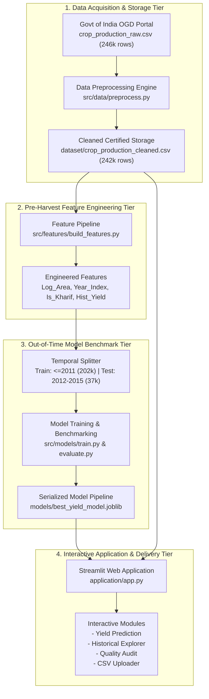

# AgriYield AI — System Architecture & Technical Specifications

## 1. High-Level Architectural Overview

**AgriYield AI** is structured as a decoupled, multi-tier data science and web application platform designed for scalable agricultural analytics, reproducible machine learning modeling, and real-time inference.

---

## 2. Component Design & Codebase Structure

The application tier is modularized under `application/src/`:
- **`src/data/`**:
  - `load_data.py`: Loads raw and processed CSV files, validates schemas against `EXPECTED_COLUMNS`, and manages memory typing.
  - `preprocess.py`: Implements raw string cleaning, missing value exclusion, unit segregation (`Unit_Type`), and ICAR biological yield outlier bounding.
- **`src/features/`**:
  - `build_features.py`: Computes leak-free pre-harvest attributes (`Log_Area`, `Year_Index`, `Is_Kharif_Monsoon`, `Farm_Scale`, `Crop_Category`, `Hist_Crop_State_Yield`).
- **`src/models/`**:
  - `train.py`: Trains Ridge, Random Forest, and HistGradientBoosting models using chronological splitting and saves the best model artifact.
  - `evaluate.py`: Generates comparative performance metrics (MAE, RMSE, $R^2$), residual distributions, and subgroup breakdowns.
  - `predict.py`: Encapsulates inference pipelines, input vector validation, and prediction interval calculations.
- **`src/visualization/`**:
  - `charts.py`: Reusable Plotly visualization functions for data audits, historical trajectories, parity plots, and custom CSV dynamic charting.
- **`tests/`**:
  - Automated test suite covering schema loading, feature transformation, and CSV upload parsing.

---

## 3. Technology Stack Specification

| Component | Framework / Library | Version | Technical Purpose |
|:---|:---|:---:|:---|
| **Runtime Language** | Python | 3.11.7 | Core execution environment |
| **Data Manipulation** | Pandas | 2.x | High-performance tabular data structures and wrangling |
| **Numeric Processing** | NumPy | 1.26.x | Vectorized matrix transformations and log calculations |
| **Machine Learning** | Scikit-Learn | 1.3+ | Regressors, transformers, and out-of-time pipeline orchestration |
| **Interactive UI** | Streamlit | 1.65.0 | Responsive web application framework |
| **Visual Charting** | Plotly & Matplotlib | 5.x / 3.8+ | Dynamic dashboard charts and static report figures |
| **Automated Testing** | Pytest | 7.4.0 | Unit test suite and CI regression verification |
| **Artifact Serialization**| Joblib | 1.3+ | Model persistence and fast deserialization |
