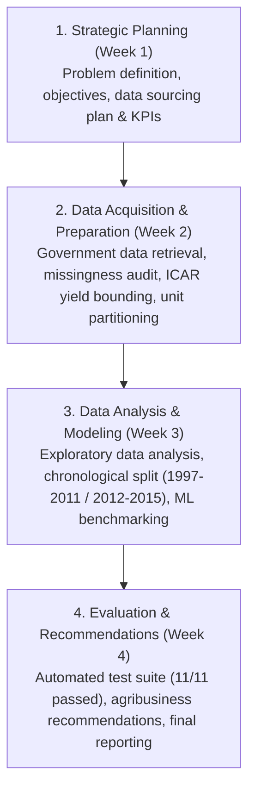

# Week 1: Project Introduction, Strategic Design & Planning

**Internship Role**: Junior Machine Learning Data Analyst — Agriculture & Agribusiness  
**Internship Organization**: YuvaIntern  
**Internship Period**: 01 October 2026 – 29 October 2026  
**Intern**: Sangeetha S (AMC Engineering College, Bengaluru)  
**Deliverable**: Week 1 Strategic Planning Document (`reports/weekly/Week1.docx`)

---

## 1. Project Introduction

Agricultural productivity forms the backbone of India's rural economy, food security, and agro-industrial supply chain. However, agricultural output is characterized by substantial spatial and seasonal volatility caused by climate variability, monsoon dynamics, land fragmentation, and regional management practices.

**AgriYield AI** is designed as a data-driven agricultural decision-support and crop-yield analysis system. By synthesizing historical multi-decade public agricultural records from the Ministry of Agriculture and Farmers Welfare, Government of India, the project aims to deliver transparent crop yield intelligence, historical productivity benchmarking, and leak-free machine learning regression models.

---

## 2. Problem Statement

Agricultural decision-making across farming communities, agricultural cooperatives, and supply-chain stakeholders frequently suffers from information asymmetry and uncertainty:
1. **High Volatility in Crop Yields**: Crop yields vary drastically across geographic regions, cropping seasons, and crop varieties.
2. **Data Inconsistency and Fragmentation**: Public administrative agricultural data often contains mixed reporting units (e.g. food grains in metric tonnes vs. coconut in thousands of nuts), missing values, and formatting discrepancies that distort statistical modeling if unaddressed.
3. **Target Leakage in Naive ML Systems**: Naive models frequently include harvested production or post-harvest variables as features when predicting yield ($\text{Yield} = \frac{\text{Production}}{\text{Area}}$), resulting in artificially inflated validation scores that fail in real-world pre-harvest deployment.
4. **Lack of Accessible Analytical Tools**: Farmers and regional agribusiness planners require interpretable, web-accessible tools to evaluate expected productivity ranges and understand historical trends without requiring deep coding expertise.

---

## 3. Aim and Objectives

### Primary Aim
To design, develop, and evaluate a reproducible end-to-end data analytics and machine learning workflow for agricultural crop yield prediction and agribusiness decision support.

### Key Objectives
1. **Source & Provenance**: Identify, document, and preserve a credible multi-decade public agricultural dataset from the Government of India Open Government Data (OGD) platform.
2. **Data Profiling & Quality Audit**: Conduct an audit of missing values, exact duplicates, administrative key collisions, numeric ranges, and measurement unit disparities.
3. **Reproducible Preprocessing Pipeline**: Build an automated data cleaning and validation pipeline preserving raw source data while writing clean outputs to a structured repository.
4. **Leak-Free Feature Engineering**: Engineer pre-harvest agronomic predictors (log-transformed acreage, temporal indices, monsoon indicators, regional historical baselines) with zero post-harvest target leakage.
5. **Exploratory Data Analysis (EDA)**: Systematically analyze multi-decade yield trajectories, state-level production hierarchies, and seasonal productivity distributions.
6. **Model Benchmarking & Evaluation**: Establish an unconditioned baseline and compare multiple regression models (Ridge Regression, Random Forest, Histogram-based Gradient Boosting) using out-of-time chronological validation.
7. **Interactive Deployment**: Provide a web-based decision-support application featuring interactive exploratory visualizers, what-if yield prediction scenarios, and an automated CSV dataset uploader.
8. **Agribusiness Decision Support**: Translate empirical findings into practical recommendations for crop planning, risk management, and procurement strategies.

---

## 4. Scope and Boundaries

### Within Scope
- Historical district-level, season-level, and crop-level agricultural records for India (1997–2015).
- Macro-level and regional yield prediction at the district-crop-season aggregation level.
- Food grains (cereals, pulses), commercial cash crops, oilseeds, and vegetables reported in metric tonnes per hectare ($t/\text{ha}$).
- Out-of-time chronological validation (train on historical past $\le 2011$, evaluate on unseen future $2012–2015$).
- Web-based interactive dashboard built with Streamlit.

### Out of Scope / Boundaries
- Parcel-level or field-scale precision farming (soil sensor telemetry, IoT sensor nodes).
- Real-time satellite spectral imagery (NDVI/EVI remote sensing pipelines).
- Prescriptive guarantees: Predictions represent expected statistical ranges and decision-support guidance, not deterministic farm-level guarantees.

---

## 5. Proposed Methodology & Lifecycle

---

## 6. Tools, Technologies & Environment

| Layer | Tools & Libraries | Purpose |
|:---|:---|:---|
| **Programming Language** | Python 3.11.7 | Core development environment |
| **Data Manipulation** | Pandas 2.x, NumPy | Data cleaning, wrangling, transformation, aggregation |
| **Machine Learning** | Scikit-Learn | Pipelines, encoders, Ridge, Random Forest, HistGradientBoosting |
| **Visualization** | Plotly, Matplotlib, Seaborn | Interactive dashboard charts and publication-grade figures |
| **Web Framework** | Streamlit | Web application user interface and interactive widgets |
| **Testing & Quality** | Pytest 7.4.0 | Unit tests for preprocessing, feature logic, and CSV upload |
| **Model Persistence** | Joblib | Model serialization and metadata export |
| **Version Control** | Git & GitHub | Source code tracking and internship repository delivery |

---

## 7. Work Planned Across the 4-Week Internship

- **Week 1**: Strategic planning, literature review, requirements definition, evaluator feedback revision, submission of `Week1.docx`.
- **Week 2**: Government dataset acquisition, schema verification, data quality audit, missing value treatment, ICAR biological bounding, feature engineering pipeline.
- **Week 3**: Exploratory data analysis, temporal split strategy, model benchmarking (Baseline, Ridge, Random Forest, HistGradientBoosting), performance breakdown by crop and season.
- **Week 4**: Project evaluation, automated test suite execution (11/11 tests), agribusiness recommendations, consolidation of final report and GitHub repository delivery.
