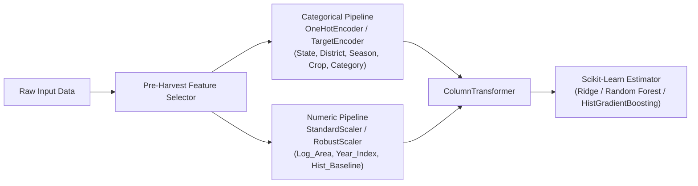

# Week 2: Feature Engineering & Leakage Safeguards

## 1. Feature Engineering Philosophy & Leakage Prevention

In predictive agricultural modeling, **data leakage** is the most frequent cause of model failure. When predicting crop yield:
$$\text{Yield} = \frac{\text{Production}}{\text{Area}}$$
Using `Production` as an input predictor provides the model with the numerator of the target, resulting in trivial $R^2 \approx 1.0$ that fails in production because actual harvested production is unknown prior to harvest.

**Strict Pre-Harvest Rule**:
- `Production` is **strictly excluded** from all candidate feature sets.
- `Area` (sown acreage) is an eligible pre-harvest predictor because farmers and revenue departments record cultivated land at planting time.
- All derived features utilize only information knowable before the harvest outcome is realized.

---

## 2. Engineered Features and Mathematical Definitions

The feature pipeline (`src/features/build_features.py`) constructs the following agronomic features:

### 1. `Yield` (Target Variable)
$$\text{Yield} = \frac{\text{Production}}{\text{Area}}$$
- **Units**: Metric Tonnes per Hectare ($t/\text{ha}$) for field crops; Thousand Nuts per Hectare for coconut.
- **Safeguard**: Calculated only where $\text{Area} > 0$. Zero-production events yield $0.00\text{ t/ha}$.

### 2. `Log_Area` (Logarithmic Acreage Transformation)
$$\text{Log\_Area} = \ln(\text{Area} + 1.0)$$
- **Rationale**: Cultivated land area spans across 8 orders of magnitude ($0.1\text{ ha}$ marginal holdings to $>8.5\text{M ha}$ aggregate regions) with extreme positive skewness ($\text{skew} > 30$). Log transformation normalizes the distribution and stabilizes linear and tree gradients.
- **Safeguard**: Offset of $+1.0$ prevents $\ln(0)$ undefined errors.

### 3. `Year_Index` (Longitudinal Technological Trend)
$$\text{Year\_Index} = \text{Crop\_Year} - 1997$$
- **Rationale**: Captures gradual secular improvements in agricultural technology, hybrid seed adoption, mechanization, and fertilizer availability over the 18-year observation window (0 to 18).

### 4. `Is_Kharif_Monsoon` (Monsoon Cropping Indicator)
$$\text{Is\_Kharif\_Monsoon} = \begin{cases} 1 & \text{if Season} = \text{'Kharif'} \\ 0 & \text{otherwise} \end{cases}$$
- **Rationale**: The Kharif season (June–October) coincides with the South-West Monsoon, which accounts for over 70% of India's annual precipitation. This binary feature provides a strong seasonal moisture regime indicator without requiring external weather API joins.

### 5. `Farm_Scale` (Operational Holding Category)
Binned cultivated area into Indian agricultural census operational holding classes:
$$\text{Farm\_Scale} = \begin{cases} \text{'Marginal'} & \text{if Area} < 1.0\text{ ha} \\ \text{'Small'} & \text{if } 1.0 \le \text{Area} < 2.0\text{ ha} \\ \text{'Semi-Medium'} & \text{if } 2.0 \le \text{Area} < 4.0\text{ ha} \\ \text{'Medium'} & \text{if } 4.0 \le \text{Area} < 10.0\text{ ha} \\ \text{'Large'} & \text{if Area} \ge 10.0\text{ ha} \end{cases}$$
- **Rationale**: Agricultural productivity frequently varies by landholding scale due to differences in mechanization and input intensity.

### 6. `Crop_Category` (Botanical & Commercial Classification)
Categorizes 124 crops into 7 macro-agronomic groupings:
- `Cereal`: Rice, Wheat, Maize, Barley, Jowar, Bajra, Ragi, Small Millets.
- `Pulse`: Gram, Arhar/Tur, Moong, Urad, Masoor, Peas & Beans, Horse-gram.
- `Oilseed`: Groundnut, Rapeseed & Mustard, Soybean, Sunflower, Sesamum, Castor Seed.
- `Cash Crop`: Sugarcane, Cotton, Jute, Tobacco.
- `Spices`: Black Pepper, Cardamom, Dry Chillies, Coriander, Turmeric, Ginger, Garlic.
- `Vegetables`: Potato, Onion, Sweet Potato, Tapioca.
- `Plantation / Other`: Tea, Coffee, Rubber, Cashewnut, Coconut.

### 7. `Hist_Crop_State_Yield` (Target-Encoded Historical State Baseline)
$$\text{Hist\_Crop\_State\_Yield}_{(c, s)} = \mathbb{E}[\text{Yield} \mid \text{Crop} = c, \text{State} = s, \text{Year} \le 2011]$$
- **Rationale**: Provides the expected historical yield for a specific crop within a given state.
- **Leakage Safeguard**: Crucially computed **exclusively on historical training data** ($\le 2011$) and merged as a static feature into future test data ($2012–2015$). Global mean yield ($4.2809\text{ t/ha}$) is imputed for unseen crop-state combinations.

---

## 3. Preprocessing & Encoding Architecture

All preprocessing, categorical encoders, and scalers are embedded inside scikit-learn `Pipeline` objects to ensure no evaluation data leaks into the training pipeline.
