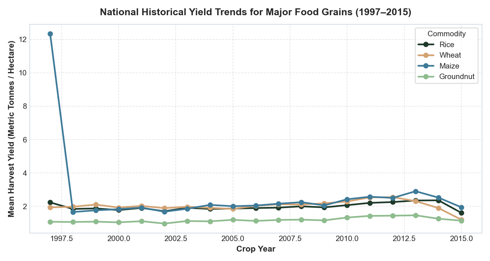
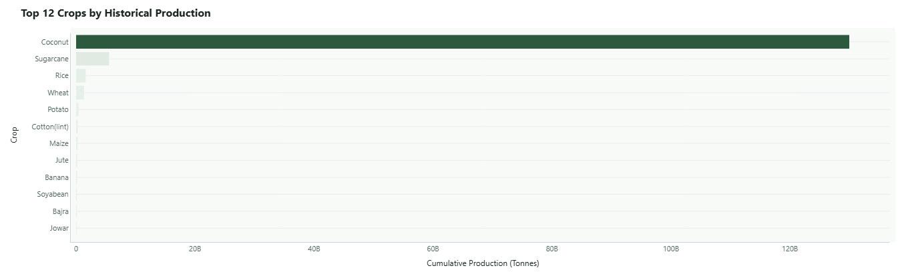
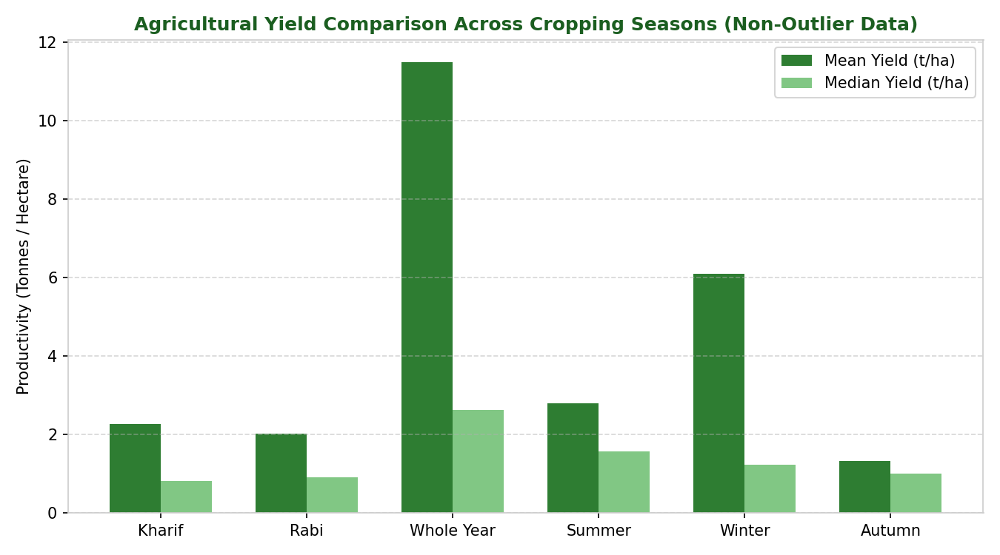

# Week 3: Exploratory Data Analysis (EDA)

## 1. Objectives of the Exploratory Analysis

Exploratory Data Analysis was conducted on the cleaned dataset `crop_production_cleaned.csv` (242,361 records) to uncover structural relationships, geographic concentrations, and temporal trends before modeling. The analysis focused on four core themes:
1. Historical Yield Trajectories & Multi-Decade Volatility
2. Commodity Production Rankings & Crop Diversity
3. Regional & State-Level Agricultural Output Concentration
4. Seasonal Yield Disparities & Agro-Climatic Influence

---

## 2. Historical Yield Trajectories (1997–2015)

Analyzing agricultural yield over 18 years reveals distinct longitudinal trends across crop categories:
- **Food Grain Stability**: Staple cereals (Rice and Wheat) exhibit steady, upward technological yield trajectories driven by irrigation expansion, hybrid cultivars, and increased mechanization. Rice national average yields rose from $\sim 1.9\text{ t/ha}$ in 1997 to $> 2.4\text{ t/ha}$ by 2014. Wheat maintains high productivity ($\sim 2.3–3.1\text{ t/ha}$) concentrated in the Indo-Gangetic Plains.
- **Monsoon Sensitivity**: Severe nation-wide drought years (notably **2002**, **2009**, and **2014–2015**) register distinct dips in rainfed crop yields (such as Jowar, Bajra, and Groundnut), underscoring the influence of South-West monsoon precipitation on non-irrigated acreage.
- **High-Biomass Crops**: Sugarcane exhibits massive biomass yield averages ($\sim 55–70\text{ t/ha}$) with substantial regional variance between peninsular India (Maharashtra, Tamil Nadu, Karnataka) and northern sub-tropical zones (Uttar Pradesh).

---

## 3. Commodity Distribution & Crop Rankings

The dataset documents 124 agricultural commodities. When evaluated by historical cumulative volume in metric tonnes:
1. **Sugarcane**: Dominates total agricultural biomass volume due to high water-to-biomass conversion efficiency.
2. **Rice**: India's primary food staple, accounting for the largest total cultivated acreage and widespread geographic distribution across all agro-ecological zones.
3. **Wheat**: Second-largest food grain, concentrated in northern rabi belts.
4. **Coarse Cereals & Cash Crops**: Cotton, Maize, Jowar, and Bajra contribute significant volume across semi-arid central and western states.
5. **Pulses**: Gram, Tur (Arhar), Urad, and Moong maintain lower per-hectare productivity ($0.5–1.0\text{ t/ha}$) but represent crucial protein security and nitrogen-fixing rotation crops.

---

## 4. Geographic & State-Level Analysis

India's agricultural production is characterized by spatial concentration:
- **Uttar Pradesh**: Consistently ranks as the highest total production volume state, driven by fertile alluvial soils in the Gangetic basin, extensive canal/tubewell irrigation networks, and leadership in Sugarcane, Wheat, and Potato.
- **Andhra Pradesh & Tamil Nadu**: High-yielding coastal delta zones for Rice and high-biomass commercial crops.
- **Punjab & Haryana**: Leading productivity zones per hectare for Rice-Wheat cropping systems.
- **Maharashtra & Madhya Pradesh**: High acreage leaders for Soybean, Cotton, Pulses, and Coarse Grains, subject to higher weather vulnerability due to significant rainfed acreage.

---

## 5. Seasonal Productivity Breakdown

Agricultural activity in India is structured around distinct cropping seasons:

| Cropping Season | Share of Records | Cropping Period | Mean Yield ($t/\text{ha}$) | Agronomic Characteristics |
|:---|:---:|:---|:---:|:---|
| **Kharif** | 38.8% | June to October | $3.69\text{ t/ha}$ | Dependent on South-West Monsoon; major rice, maize, cotton, and pulse belt |
| **Rabi** | 27.5% | October to April | $2.95\text{ t/ha}$ | Winter post-monsoon; reliant on residual soil moisture, tube wells, and western disturbances (Wheat, Mustard, Gram) |
| **Whole Year** | 18.2% | Multi-season | $14.25\text{ t/ha}$ | Long-duration crops including Sugarcane, Banana, and perennial horticulture |
| **Summer** | 6.1% | March to June | $3.85\text{ t/ha}$ | Irrigated summer crops (Zaid pulses, vegetables, summer groundnut) |
| **Winter** | 5.3% | Cold season | $6.79\text{ t/ha}$ | Eastern and southern winter rice and specialty horticulture |
| **Autumn** | 4.1% | Early harvest | $1.47\text{ t/ha}$ | Early maturing varieties in eastern riverine floodplains |

