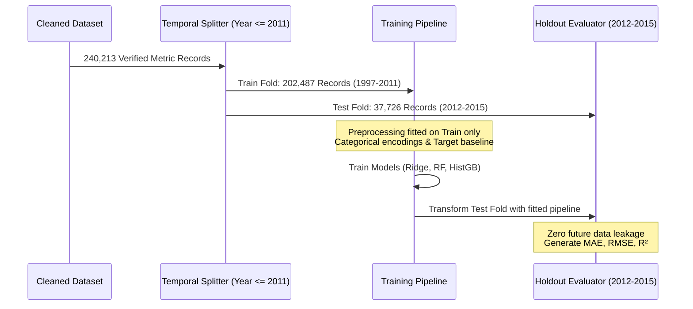

# Week 3: Machine Learning Methodology & Training Strategy

## 1. Predictive Problem Formulation

The modeling task in AgriYield AI is framed as a **supervised regression problem**:
$$\hat{y} = f(\mathbf{x})$$
where:
- $\hat{y}$ is predicted crop productivity in Metric Tonnes per Hectare ($t/\text{ha}$).
- $\mathbf{x}$ is a vector of pre-harvest geographic, administrative, botanical, seasonal, and acreage features.

### Observation Unit
The unit of analysis is a distinct **District–Crop–Season–Year** agricultural record:
$$\text{Record}_i = (\text{State}_i, \text{District}_i, \text{Season}_i, \text{Crop}_i, \text{Year}_i, \text{Area}_i)$$

### Eligible Input Features
To ensure real-world deployability at sowing/planning time, candidate features are restricted to variables known **prior to harvesting**:
1. `State_Name` (Categorical)
2. `District_Name` (Categorical)
3. `Season` (Categorical)
4. `Crop` (Categorical)
5. `Crop_Category` (Categorical)
6. `Farm_Scale` (Categorical)
7. `Log_Area` (Numerical: $\ln(\text{Area} + 1)$)
8. `Year_Index` (Numerical: $\text{Crop\_Year} - 1997$)
9. `Is_Kharif_Monsoon` (Binary indicator)
10. `Hist_Crop_State_Yield` (Numerical: historical state-crop average yield up to 2011)

---

## 2. Validation Design: Out-of-Time Chronological Split

Random cross-validation (K-Fold CV) is fundamentally invalid for longitudinal agricultural forecasting. Because agricultural yields share strong temporal autocorrelation and technological trends, a random shuffle allows future data points to leak into past predictions, artificially inflating $R^2$.

### Temporal Holdout Split
To simulate genuine forward-looking forecasting, an **Out-of-Time Chronological Validation Split** was implemented:
- **Training Set ($\le 2011$)**: 1997 to 2011 (15 years) $\rightarrow$ **202,487 records**
- **Test Set ($> 2011$)**: 2012 to 2015 (4 unseen future years) $\rightarrow$ **37,726 records**
- **Total Modeled Records**: 240,213 records (excluding coconut and flagged biological outliers)

All preprocessing transformations, categorical encoders, scalers, and target baselines were fitted **exclusively on the training partition ($\le 2011$)** and subsequently applied to the holdout test set.

---

## 3. Candidate Algorithms and Rationale

Four model architectures spanning baseline benchmarks, linear modeling, ensemble bagging, and gradient boosting were evaluated:

### 1. Baseline Predictor (Unconditioned Training Mean)
- **Role**: Essential null benchmark.
- **Formulation**: Predicts the constant scalar training set mean:
  $$\hat{y}_i = \bar{y}_{\text{train}} = 4.2809\text{ t/ha}$$
- **Purpose**: Establishes the lower bound of predictive performance. Any viable machine learning model must substantially outperform this benchmark.

### 2. Ridge Regression (L2 Regularized Linear Model)
- **Role**: Parametric linear baseline.
- **Formulation**:
  $$\min_{\mathbf{w}} \|\mathbf{y} - \mathbf{X}\mathbf{w}\|_2^2 + \alpha \|\mathbf{w}\|_2^2$$
- **Strengths**: High computational efficiency (0.35s training time), full transparency, and resilience against multi-collinearity.
- **Limitations**: Inability to capture complex non-linear interactions between soil-climate zones and specific crop varieties.

### 3. Random Forest Regressor (Ensemble Bagging)
- **Role**: Non-parametric ensemble candidate.
- **Architecture**: 60 decision trees, maximum tree depth 14, minimum samples per leaf 10.
- **Strengths**: Captures complex non-linear feature interactions and threshold effects without requiring feature normality assumptions.
- **Limitations**: Substantial model artifact size and inability to extrapolate outside observed numerical ranges.

### 4. Histogram-based Gradient Boosting Regressor (Champion Model)
- **Role**: State-of-the-art non-linear gradient tree boosting.
- **Architecture**: `HistGradientBoostingRegressor` with native categorical feature support, maximum depth 12, early stopping.
- **Strengths**: Binning continuous features into 256 integer buckets dramatically accelerates training on large datasets ($>200\text{k}$ rows), natively processes categorical hierarchies, and minimizes asymmetric loss.

---

## 4. Leakage Prevention Architecture

