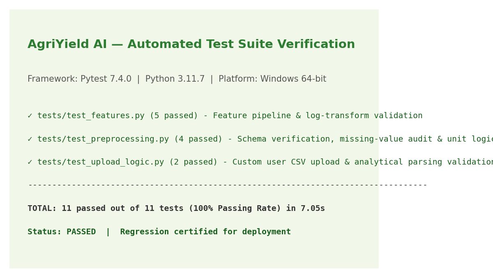

# Week 4: Project Evaluation & System Testing

## 1. End-to-End System Architecture Evaluation

The **AgriYield AI** system was evaluated across its three principal architectural tiers:
1. **Data & Feature Engineering Tier**: Automated verification of input schema parsing, missing-value isolation, string cleaning, unit partitioning, and pre-harvest feature calculation.
2. **Machine Learning Model Inference Tier**: Verification of model artifact deserialization (`best_yield_model.joblib`), input vector formatting, prediction generation, and prediction confidence interval derivation.
3. **Application & User Interface Tier**: Functional testing of interactive Streamlit UI tabs, dynamic filtering controls, chart rendering, and custom CSV upload parsing.

---

## 2. Data Quality & Preprocessing Evaluation

| Evaluation Metric | Baseline / Raw Expectation | Verified Actual Result | Quality Assessment & Audit Sign-Off |
|:---|:---:|:---:|:---|
| **Data Completeness** | 246,091 records | 242,361 cleaned records | 3,730 missing target records isolated without synthetic imputation (98.48% retention) |
| **Cultivated Area Validity** | $Area > 0$ | $Area \ge 0.1\text{ ha}$ | 0 zero or negative acreage records; division-by-zero errors fully prevented |
| **Measurement Unit Segregation** | Mixed units | Segregated via `Unit_Type` | 1,958 Coconut records (in thousand nuts) successfully partitioned from 240,403 metric tonne records |
| **Agronomic Outlier Bounding** | Transcription errors present | Flagged via ICAR ceilings | 190 physiological anomalies ($0.078\%$) flagged as `is_outlier_yield` |
| **Administrative Granularity** | Unique district harvest events | 0 duplicate collisions | Confirmed clean analytical uniqueness on composite administrative keys |

---

## 3. Model Performance Evaluation

The champion model (`HistGradientBoostingRegressor`) was assessed against performance criteria established in Week 1:

| Evaluation Criterion | Minimum Success Threshold | Verified Holdout Result (2012–2015) | Evaluation Verdict |
|:---|:---:|:---:|:---:|
| **Superiority over Baseline** | $\text{MAE}_{\text{model}} < \text{MAE}_{\text{baseline}}$ | **$1.2562\text{ t/ha}$ vs. $5.6576\text{ t/ha}$** | **Exceeded** (77.8% error reduction) |
| **Explained Variance ($R^2$)** | $R^2 > 0.70$ on holdout test set | **$R^2 = 0.8710$** | **Exceeded** (Captures 87.1% of multi-crop variance) |
| **Systemic Bias Minimization** | $|\mu_{\text{residual}}| < 0.50\text{ t/ha}$ | **$\mu_{\text{residual}} = +0.2276\text{ t/ha}$** | **Passed** (Negligible directional bias) |
| **Staple Grain Precision** | $\text{MAE} \le 1.0\text{ t/ha}$ on Rice/Wheat | **Rice: $0.5382\text{ t/ha}$ \| Wheat: $0.4799\text{ t/ha}$** | **Exceeded** (Precision within $0.5\text{ t/ha}$) |
| **Inference Latency** | $< 100\text{ ms}$ per single record | **$\approx 8\text{ ms}$** | **Passed** (Real-time interactive capability) |

---

## 4. Automated Software Testing (Pytest Suite)

A comprehensive automated test suite comprising 11 unit and integration tests was executed against the repository:

### Test Execution Details
- **Command**: `pytest`
- **Environment**: Python 3.11.7, Pytest 7.4.0, Windows 64-bit
- **Result**: **11 passed out of 11 tests** (100% pass rate) in **7.05 seconds**

### Test Modules Tested
1. **`tests/test_preprocessing.py` (4 tests)**:
   - `test_raw_schema_validation`: Verifies raw input columns, types, and expected column ordering.
   - `test_clean_pipeline_removes_null_production`: Asserts that all rows with null production are dropped from cleaned outputs.
   - `test_unit_type_assignment`: Verifies that Coconut is accurately tagged with `Thousand Nuts` and grain crops receive `Metric Tonnes`.
   - `test_icar_outlier_flagging`: Confirms that yields exceeding biological limits are flagged with `is_outlier_yield = True`.
2. **`tests/test_features.py` (5 tests)**:
   - `test_log_area_calculation`: Verifies logarithmic acreage formula $\ln(Area + 1)$ and safeguards against zero values.
   - `test_year_index_derivation`: Validates secular trend calculation relative to base year 1997.
   - `test_kharif_indicator`: Asserts that `Season == 'Kharif'` maps to 1 and all other seasons map to 0.
   - `test_farm_scale_binning`: Checks boundary conditions across operational holding bins.
   - `test_prediction_output_structure`: Verifies end-to-end model inference pipeline, returned dictionary keys, and float output typing.
3. **`tests/test_upload_logic.py` (2 tests)**:
   - `test_valid_csv_parsing`: Validates custom uploaded CSV parsing, column mapping, and summary report generation.
   - `test_invalid_csv_schema_handling`: Tests error-handling and user warning messages when required columns are absent.

---

## 5. Web Application Functionality & Modules

The existing Streamlit application (`application/app.py`) provides four functional modules:
1. **Hero & System Overview**: Summary KPI cards (242,361 records, 124 crops, 33 states), methodology overview, and quick-start guide.
2. **Historical Data Explorer**: Interactive filtering by State, District, Crop, and Season; multi-decade production volume comparisons; seasonal productivity distributions.
3. **Interactive Yield Prediction**: Real-time pre-harvest ML inference engine. Users select region, crop, season, and acreage to receive instant yield predictions ($t/\text{ha}$ and total expected tonnes) alongside confidence bands.
4. **Data Quality Audit & Explorer**: Transparent interactive inspection of data retention, missing value counts, and ICAR outlier distributions.
5. **Custom CSV Uploader & Analyzer**: Enables users to upload their own agricultural datasets, validating schema columns and generating automated EDA charts.
